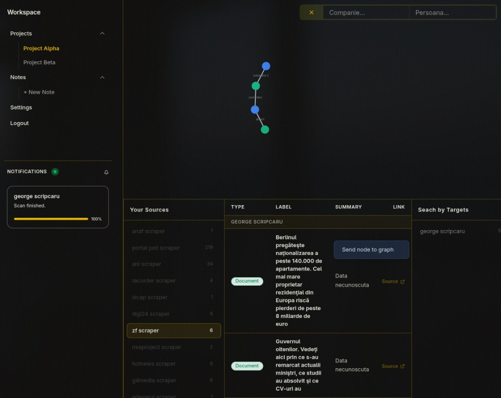
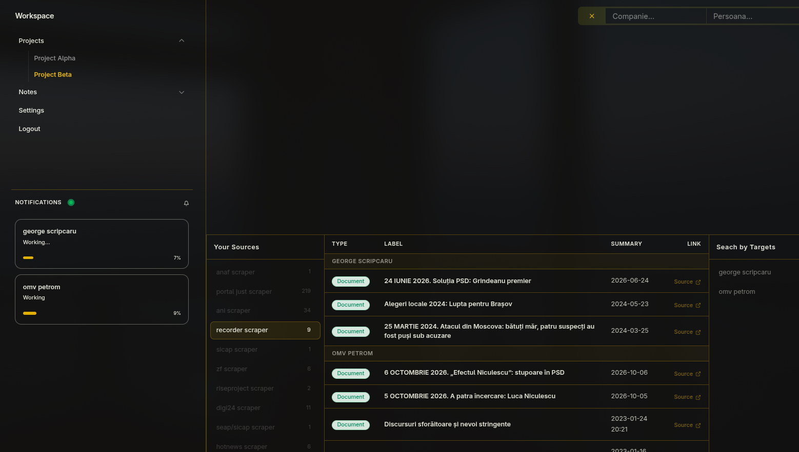
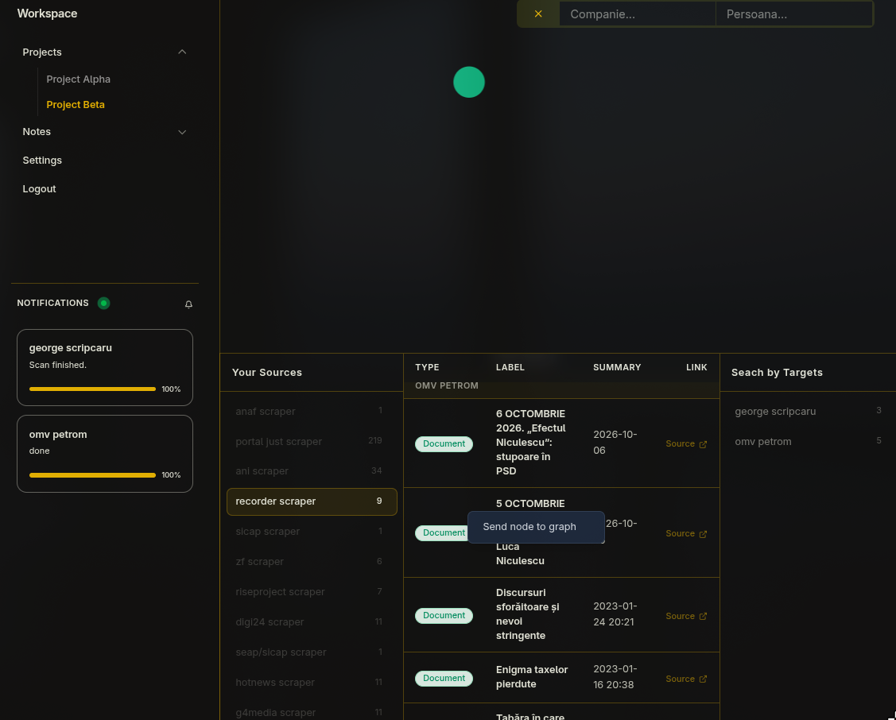
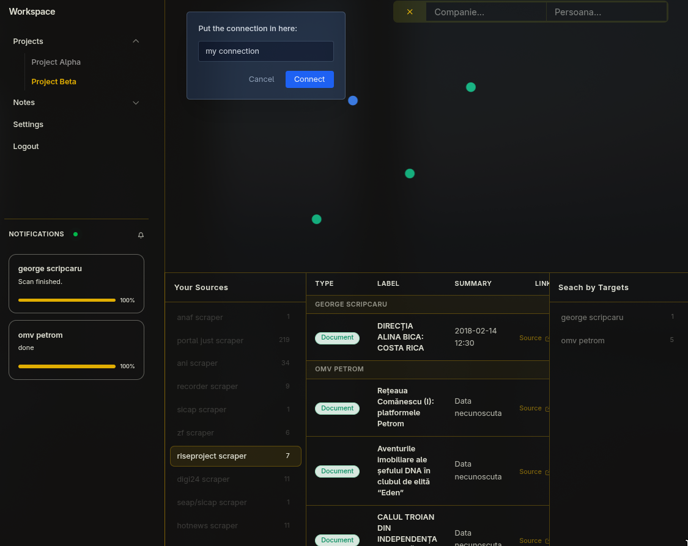
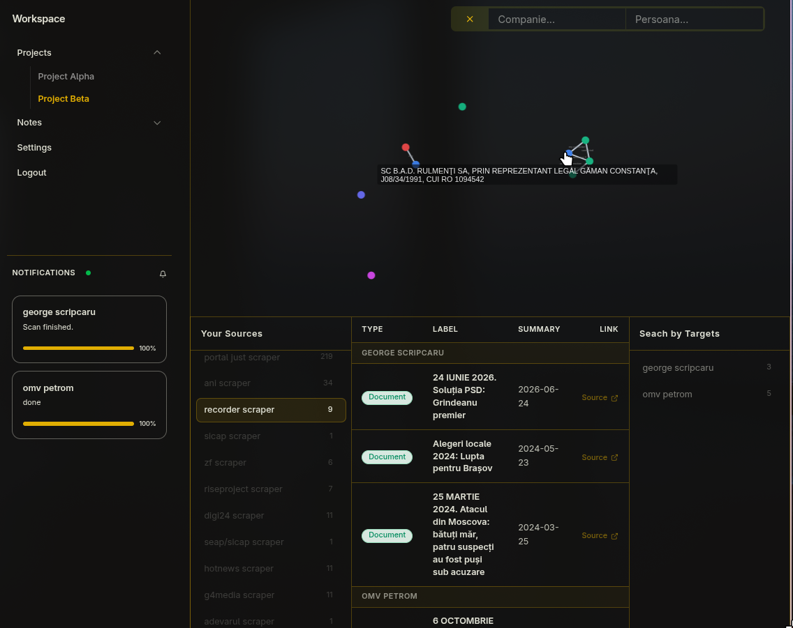

# e-Scraps

E-Scraps is an Open-Source Intelligence data visualization platform designed to aggregate, analyze, and map connections between different entities in Romania, our ideal was to develop an platform that provides a libre, open source tool to help anyone with a computer systematically access Romanian news, legal sources, amongst others, as our attempt for transparency in an otherwise pretty obfuscated govt system.

The platform allows users to perform deep-dive searches on individuals and companies across multiple Romanian public databases, institutional registries, and media outlets. The results are streamed in real-time via WebSockets and can be visually mapped onto an interactive node type graph to uncover relationships between entities.

  
<strong>Screenshots</strong>

   

  
  
  
  
  
  
  
  
  

## Features

*   **Real-time Scraping Engine:** uses a Python/FastAPI backend withWebSocket integration to stream scraping progress and results directly to the client in real time
*   **Interactive Node Graph:** the user can send search results (Persons, Companies, Documents, Media) to a visual workspace to build out connection maps and relationship networks
*   **Comprehensive Data Sources:** the user has built-in scrapers at their disposal, to scour Romanian institutions and publications 
*   **Authentication & Workspaces:** secure user authentication with support for distinct projects and notes per each project

## Supported Data Sources (Scrapers)

Scraper sources:

**Institutions & Registries:**
*   **ANAF** (Financial data, VAT status, administrators)
*   **Portal Just** (Court cases and legal history)
*   **ANI** (Wealth and interest declarations)
*   **SEAP / SICAP** (Public procurement and contracts)

**Journalism & News (Investigative & Mainstream):**
*   Recorder
*   RiseProject
*   Ziarul Financiar (ZF)
*   Adevărul
*   Digi24
*   G4Media
*   Hotnews

**Additional ones:**
*   Social Media Profiles
*   DuckDuckGo (General web search)

## The team who worked on this project:

* Andrei Scurtu - *Team Leader*, came up with the project idea, docker orchestation, dashboard, scrapers, scraper integration, scraper backend, frontend UI
* Robert Cozma - UI website design, scrapers, selenium experiments, animations
* Denisa Turea - UI website design, ANAF scraper
* Zoltan Csabai  - UI website design, all scrapers, scraper formatting
* Andrei Rotaru - Enterprise page
* Catalin Palade - Authentication (backend - django)
* Raul Oncioiu - Authentication (frontend - Login, Register pages)

